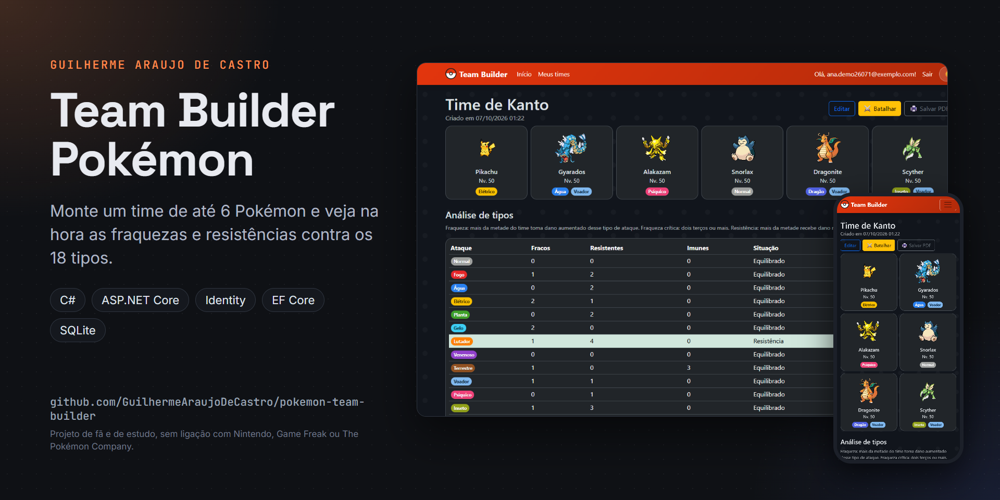
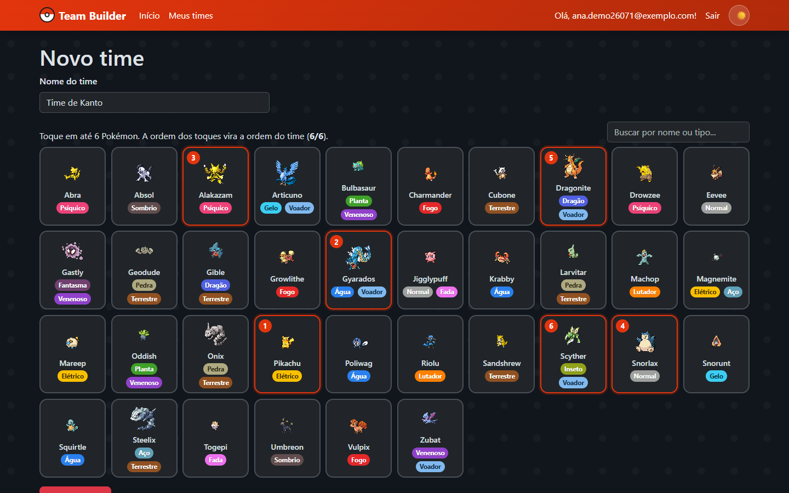
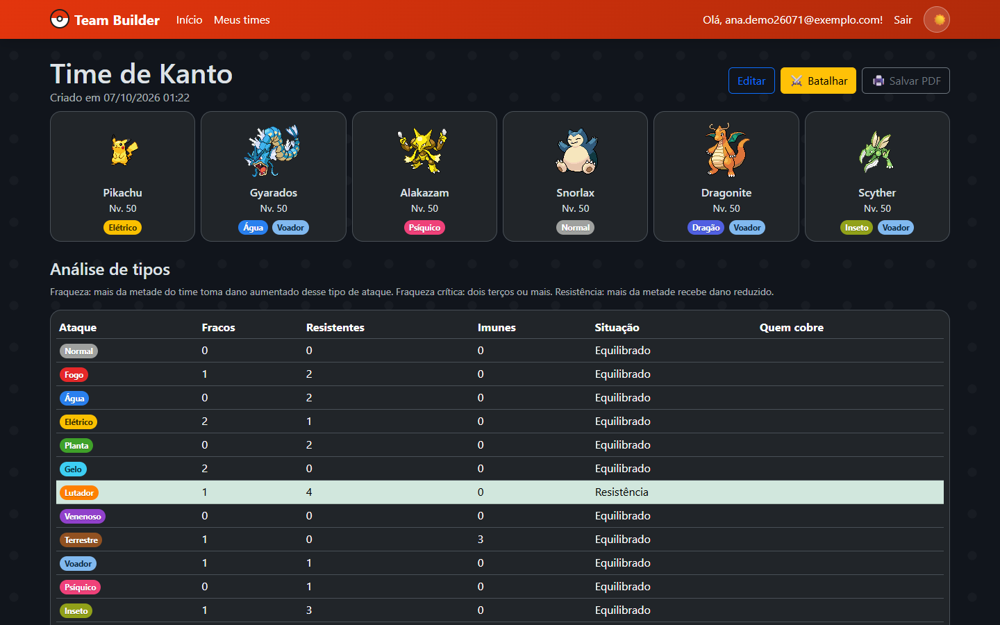
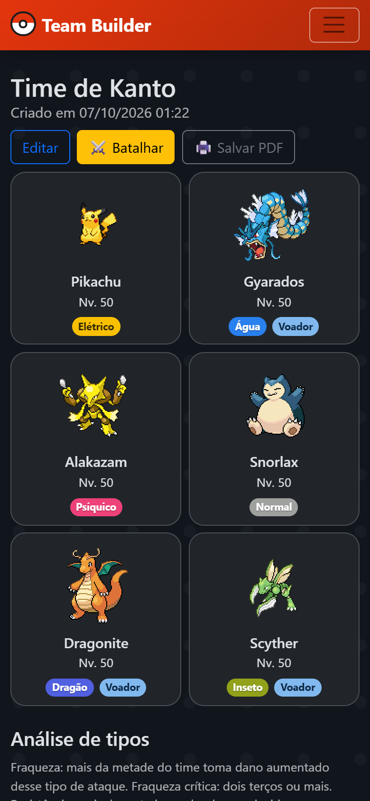

# Team Builder Pokémon



[](https://github.com/GuilhermeAraujoDeCastro/pokemon-team-builder/actions/workflows/ci.yml)

Site em ASP.NET Core onde cada pessoa cria uma conta, monta times de até 6 Pokémon e vê na hora quais tipos de ataque são fraqueza ou resistência do time inteiro, com sugestão de quem adicionar pra cobrir os buracos. Roda na sua máquina, sem site publicado. É o segundo projeto da minha trilogia Pokémon: o primeiro foi o [Simulador de Batalha](https://github.com/GuilhermeAraujoDeCastro/pokemon-battle-simulator) em Python e o terceiro é o [Analisador de Dados](https://github.com/GuilhermeAraujoDeCastro/pokemon-data-analyzer).

## O que o site faz

- Login com ASP.NET Core Identity. Cada conta só vê os próprios times.
- Catálogo inicial de 36 Pokémon que cobre os 18 tipos. Dá pra trazer qualquer outro pelo nome, buscando na PokéAPI.
- Times com apelido e nível (1 a 100) pra cada Pokémon.
- Análise do time contra os 18 tipos de ataque: quantos membros são fracos, resistentes ou imunes a cada um. Mais da metade fraca vira fraqueza, dois terços ou mais vira fraqueza crítica.
- Sugestões pra cada fraqueza, com destaque pros Pokémon que resistem a duas ou mais fraquezas de uma vez.
- Histórico de alterações de cada time, com opção de voltar pra uma versão anterior.
- Lixeira: time excluído pode ser restaurado ou apagado de vez.
- Simulação de batalha entre dois times, turno a turno, usando a tabela de tipos e o nível de cada Pokémon.
- Página pública só leitura pra compartilhar um time.
- API em JSON: catálogo público em `/api/pokemon`, times da conta em `/api/teams` e análise em `/api/teams/{id}/analysis`. A análise aceita o dono autenticado ou um time público com dono válido.
- Nomes dos tipos em português na tela e tema claro e escuro (Bootstrap 5.3).

## Telas

| Montando um time | Análise de tipos | No celular |
|---|---|---|
|  |  |  |

## Como rodar

Precisa do SDK do .NET 8 (dotnet.microsoft.com/download).

```bash
cd src/TeamBuilderPokemon
dotnet run
```

O banco SQLite (`app.db`) é criado e atualizado na primeira execução pelas migrations. Antes de usar um banco existente, faça backup e siga o [procedimento de migração e quarentena de donos](docs/owner-migration.md) em uma cópia local. O terminal mostra a URL local, algo como `https://localhost:7xxx`. Crie uma conta e entre em "Meus times".

A confirmação de cadastro por e-mail vem desligada. Pra ligar, coloque `"Email": { "RequireConfirmedAccount": true }` no `appsettings.json`. Os e-mails não são enviados de verdade: viram arquivos `.html` em `App_Data/emails`, o que dispensa conta em provedor de e-mail. Pra usar em produção, troque o `FileEmailSender` por SendGrid ou SMTP.

Se mudar os modelos e precisar de uma migration nova, execute os comandos a partir da raiz do repositório. Defina antes `ConnectionStrings__DefaultConnection` para o banco local de design, conforme `.env.example` e o guia de migração:

```bash
dotnet tool restore
dotnet ef migrations add NomeDaMudanca --project src/TeamBuilderPokemon
```

O GitHub Actions compila o projeto e executa as regressões em SQLite a cada push.

## Arquitetura

```
TeamBuilderPokemon.sln
src/TeamBuilderPokemon/
  Models/          Pokemon, Team, TeamSlot (apelido e nível), TeamRevision (histórico) e o catálogo inicial
  Services/
    TypeChart.cs        tabela de 18 tipos, a mesma do simulador em Python
    TeamAnalyzer.cs     fraquezas, resistências e sugestões de um time
    TeamRules.cs        regras de um time válido
    BattleSimulator.cs  batalha entre dois times
    PokeApiClient.cs    busca de Pokémon novos na PokéAPI
    TypeNames.cs        nomes dos tipos em português
    FileEmailSender.cs  e-mail salvo em arquivo
  Controllers/     TeamsController (telas) e ApiController (JSON)
  Views/           telas dos times, batalha, lixeira e página pública
  Data/            contexto do EF Core e migrations
```

`TypeChart`, `TeamAnalyzer`, `TeamRules` e `BattleSimulator` não conhecem Entity Framework nem ASP.NET. Assim a regra de negócio inteira roda sem banco e sem HTTP, do mesmo jeito que o simulador em Python separa o cálculo de dano do resto.

## O que eu treinei com esse projeto

ASP.NET Core MVC com ASP.NET Core Identity, Entity Framework Core com SQLite e seed por `HasData`, e um relacionamento muitos-para-muitos com dados extras (posição, apelido e nível) modelado como entidade própria. Também portei a mesma lógica de domínio, a tabela de tipos, de Python pra C#, mantendo os dois lados consistentes.

## Importação, revisões e dados da conta

"Importar JSON" em Meus times aceita o formato versionado do projeto. A prévia mostra nome, membros, níveis, apelidos e visibilidade. Nada é salvo até a confirmação; o servidor valida novamente todo o conteúdo antes de criar um time. "Exportar JSON" nos detalhes permite voltar com os mesmos campos. Espécies desconhecidas precisam entrar no catálogo antes dessa importação. O formato Showdown não está implementado.

Importar uma espécie na tela de criação ou edição atualiza o catálogo sem navegar para outra página. Nome, seleções, níveis, apelidos e visibilidade do rascunho continuam preenchidos. Falhas da PokeAPI aparecem no próprio formulário.

O histórico abre uma comparação por nome, visibilidade e slot antes da restauração. Restaurar mantém uma revisão da versão substituída. O download dos dados pessoais do Identity inclui times e histórico; a exclusão explícita da conta remove esses dados por chave estrangeira. Times antigos sem dono válido ficam em quarentena privada, com seus dados preservados para revisão local.

```bash
dotnet run --project tests/RegressionTests -c Release
```

Os testes usam SQLite em memória e chamadas simuladas da PokeAPI. Consulte [migração, configuração e limites dos testes](docs/owner-migration.md) antes de trabalhar com progresso existente.

## Créditos e avisos

Os dados e os sprites vêm da [PokéAPI](https://pokeapi.co/). O Bootstrap e o jQuery, em `src/TeamBuilderPokemon/wwwroot/lib`, seguem a licença MIT de cada um, que acompanha os arquivos. Pokémon é marca da Nintendo, da Game Freak e da The Pokémon Company. Este é um projeto de fã e de estudo, sem fins lucrativos e sem ligação com essas empresas.

## Licença e contato

Código sob a licença MIT (veja [LICENSE](LICENSE)). Feito por Guilherme Araujo de Castro: [portfólio](https://guilhermearaujodecastro.vercel.app) · [LinkedIn](https://www.linkedin.com/in/guilherme-araujo-de-castro) · guilhermeacastro.2006@gmail.com
